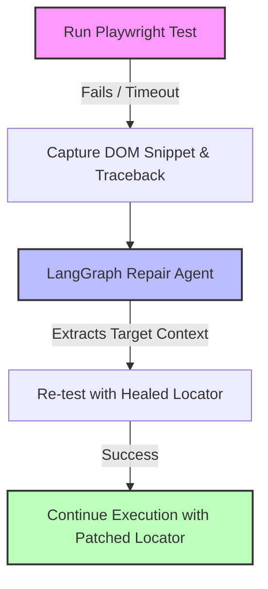

# Autonomous Playwright Healer

An agentic self-healing testing prototype combining **Playwright**, **LangGraph**, and **Python**. It is designed to diagnose failed E2E element locators, inspect DOM snapshots, and attempt runtime locator repair during test execution.

## Key Features
- **Cyclic Agentic Graph:** Uses LangGraph state machines to orchestrate execution, diagnosis, and patching loops.
- **Dynamic DOM Inspection:** Parses DOM trees after assertion timeouts to identify likely target interactables.
- **Prototype Self-Healing Flow:** Attempts autonomous repair passes before marking the test as failed, helping explore how self-healing locator recovery could work in practice.

##  Architecture Overview

The framework hooks into the test lifecycle to intercept runtime exceptions, process the failed context, and attempt recovery:



##  Core Components

* **Playwright Test Runner:** Runs end-to-end test flows against the target application.
* **Failure Interceptor:** Catches `TimeoutError` or strict-mode selector failures, then collects the relevant DOM snapshot and Python stack trace.
* **LangGraph Repair Agent:** A stateful, multi-step LLM graph that isolates the broken selector, references the captured DOM snippet, and proposes an alternative locator.
* **Healing Pipeline Prototype:** Re-executes the step with the patched locator and records the suggested fix for further review.

## How It Works

1. A Playwright test runs normally.
2. If a locator-based failure happens, the framework captures the error context.
3. The captured DOM snapshot and failure details are passed into a LangGraph-driven repair workflow.
4. The repair workflow proposes a new locator.
5. The framework retries the failed step using the proposed locator.
6. If the retry succeeds, the repaired locator can be reviewed as a candidate fix.

## Current Scope

This project is a prototype intended to explore self-healing UI automation patterns.

It focuses on:
- runtime detection of broken locators
- DOM-aware repair attempts
- agentic retry logic
- experimentation with LLM-guided recovery workflows

## Quickstart

```bash
# 1. Clone & Setup
git clone https://github.com/anshi43/autonomous-playwright-healer.git
cd autonomous-playwright-healer
python3 -m venv venv
source venv/bin/activate
pip install -r requirements.txt
playwright install chromium

# 2. Run Self-Healing Test
pytest -v tests/test_runner.py
```

## Why This Project Matters

This project explores how LLM-assisted agents can improve UI automation resilience by reacting to locator failures dynamically instead of failing immediately.

It is useful for investigating:
- self-healing test automation patterns
- locator recovery strategies
- agentic orchestration in test execution
- LLM-guided debugging workflows for browser automation

## Current Limitations

This prototype does not guarantee successful locator recovery in every failure scenario.

Its current purpose is to demonstrate and experiment with the self-healing workflow, rather than provide production-ready reliability.

## Future Improvements

Possible next improvements for this repository:
- stronger locator ranking and validation
- support for more failure categories beyond locator issues
- better DOM summarization before LLM input
- confidence scoring for proposed fixes
- persistent storage of accepted healed locators
- CI evaluation on repeated flaky scenarios

## Author

**Ankit Mavani**  
Berlin, Germany

- GitHub: [https://github.com/anshi43](https://github.com/anshi43)
- LinkedIn: [https://www.linkedin.com/in/ankitmavani/](https://www.linkedin.com/in/ankitmavani/)
- Email: [mavaniankit09@gmail.com](mailto:mavaniankit09@gmail.com)
