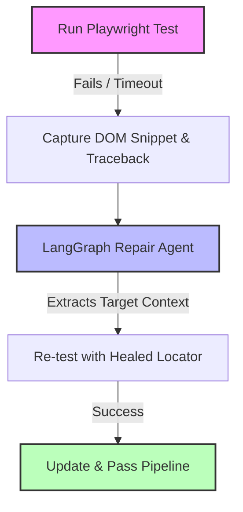

# Autonomous Playwright Healer 🤖✨

An agentic self-healing testing framework combining **Playwright**, **LangGraph**, and **Python**. Automatically diagnoses failed E2E element locators, inspects DOM snapshots, and dynamically repairs stale locators in runtime.

## Key Features
- **Cyclic Agentic Graph:** Uses LangGraph state machines to orchestrate execution, diagnosis, and patching loops.
- **Dynamic DOM Inspection:** Parses DOM trees upon assertion timeouts to locate target interactables.
- **Zero-Downtime E2E Execution:** Avoids flaky build interruptions by attempting autonomous repair passes before marking pipelines as failed.


## 🏗️ Architecture Overview

The framework hooks into the test lifecycle to intercept runtime exceptions, process the failed context, and attempt real-time recovery:



## 🛠️ Core Components

*   **Playwright Test Runner:** Runs end-to-end integration flows against your target application.
*   **Failure Interceptor:** Catches `TimeoutError` or strict-mode selector failures, immediately pulling the relevant **DOM tree snapshot** and Python stack trace.
*   **LangGraph Repair Agent:** A stateful, multi-step LLM graph that isolates the broken selector, references the captured DOM snippet, and generates a valid alternative locator.
*   **Healing Pipeline:** Re-executes the step on-the-fly with the patched locator to heal the pipeline mid-run before logging the suggested permanent fix.

## Quickstart

```bash
# 1. Clone & Setup
git clone [https://github.com/anshi43/autonomous-playwright-healer.git](https://github.com/anshi43/autonomous-playwright-healer.git)
cd autonomous-playwright-healer
python3 -m venv venv
source venv/bin/activate
pip install -r requirements.txt
playwright install chromium

# 2. Run Self-Healing Test
pytest -v tests/test_runner.py
